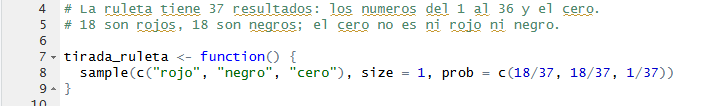
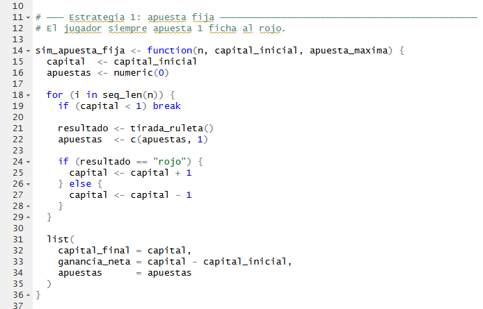
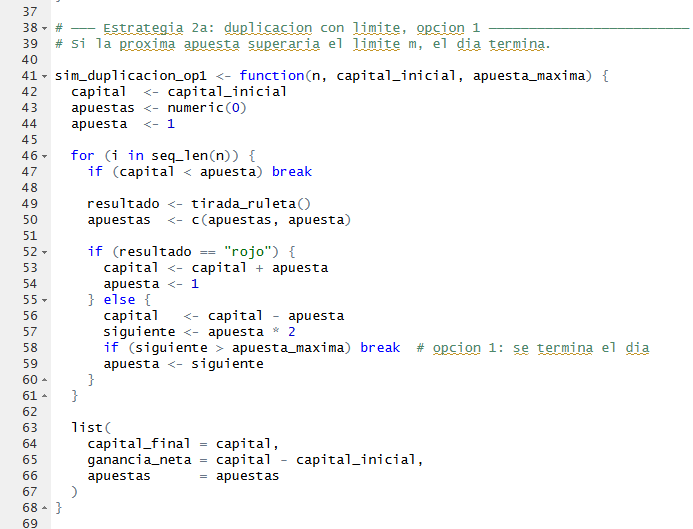
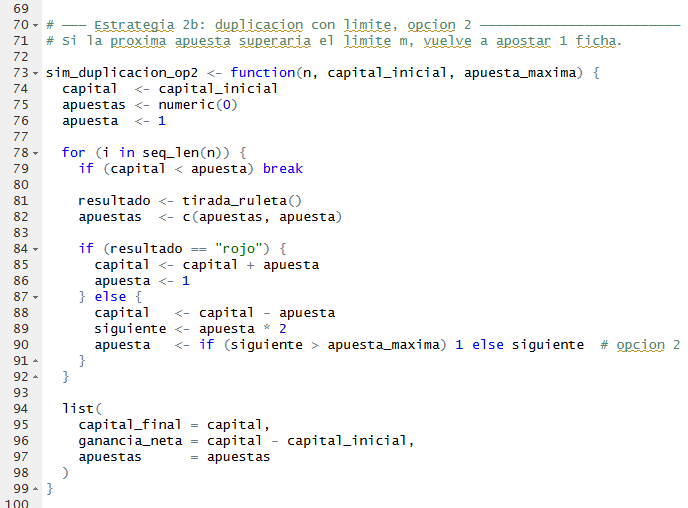
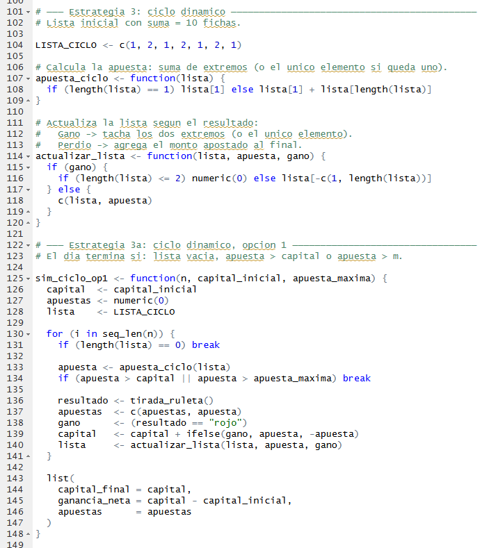
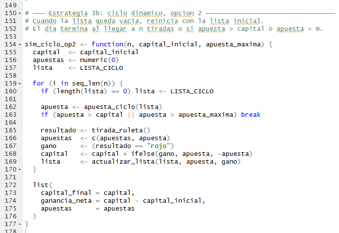
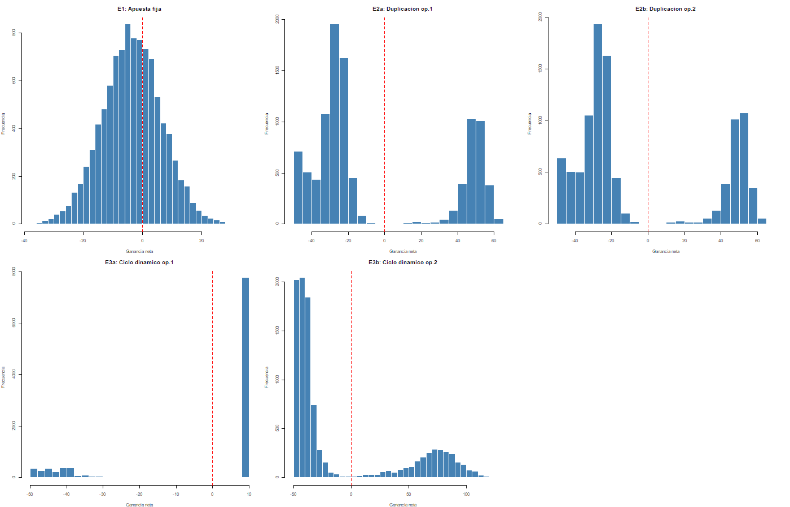
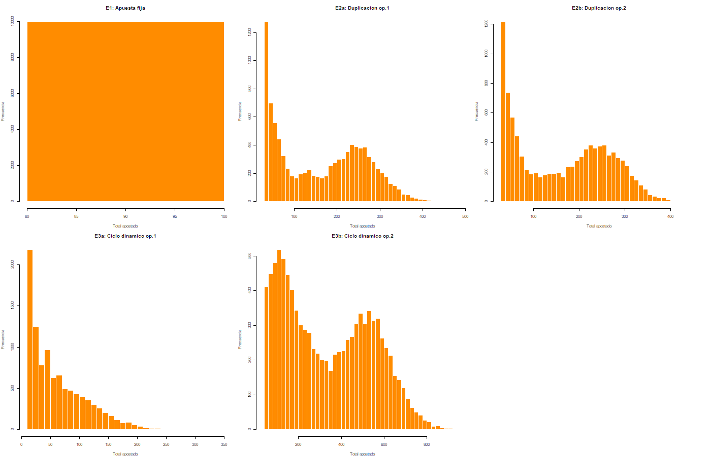
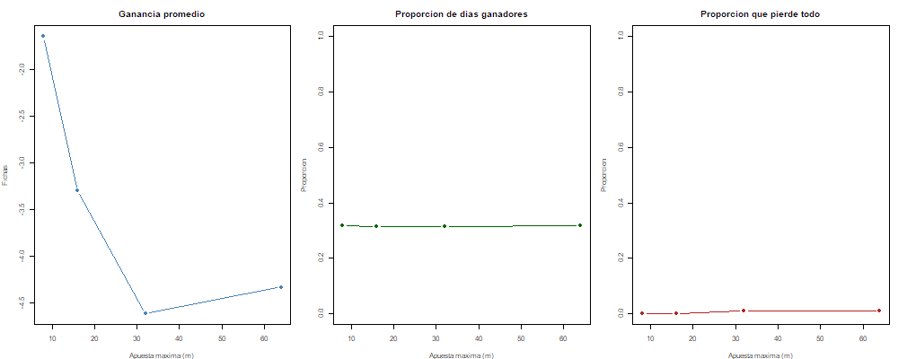

# Trabajo Práctico: Estrategias de Apuestas en la Ruleta
**Probabilidad y Estadística — Segundo semestre 2026**

---

## 1. Introducción

Se estudian cinco estrategias de apuestas en la ruleta europea mediante simulación computacional en R. La ruleta tiene 37 resultados posibles (0 al 36), de los cuales 18 son rojos, 18 negros y el cero no tiene color. En cada tirada se apuesta al rojo: el jugador gana tantas fichas como apostó si sale rojo, y pierde la cantidad apostada si sale negro o cero.

Cada sesión diaria consta de `n` tiradas. El jugador comienza con un capital inicial de `C` fichas y no puede apostar más de lo que tiene. Los parámetros usados son `n = 100`, `C = 50`, `m = 64` (apuesta máxima permitida por el casino).

Las cinco estrategias simuladas son:

| Estrategia | Descripción |
|---|---|
| E1 | Apuesta fija: siempre apuesta 1 ficha |
| E2a | Duplicación con límite, opción 1: si duplicar supera `m`, termina el día |
| E2b | Duplicación con límite, opción 2: si duplicar supera `m`, vuelve a apostar 1 |
| E3a | Ciclo dinámico, opción 1: el día termina si la lista se tacha o se supera un límite |
| E3b | Ciclo dinámico, opción 2: al tachar la lista, reinicia; el día termina en `n` tiradas o al superar límites |

---

## 2. Código R

### Función `tirada_ruleta` — `ruleta.R`, líneas 7–9

<!-- CAPTURA: abrir ruleta.R en RStudio, capturar líneas 7 a 9 -->

### Estrategia E1: apuesta fija — `ruleta.R`, líneas 14–36

<!-- CAPTURA: ruleta.R líneas 14 a 36 -->

### Estrategia E2a: duplicación opción 1 — `ruleta.R`, líneas 41–68

<!-- CAPTURA: ruleta.R líneas 41 a 68 -->

### Estrategia E2b: duplicación opción 2 — `ruleta.R`, líneas 73–99

<!-- CAPTURA: ruleta.R líneas 73 a 99 -->

### Estrategia E3a: ciclo dinámico opción 1 — `ruleta.R`, líneas 104–148

<!-- CAPTURA: ruleta.R líneas 104 a 148 -->

### Estrategia E3b: ciclo dinámico opción 2 — `ruleta.R`, líneas 150–177

<!-- CAPTURA: ruleta.R líneas 150 a 177 -->

---

## 3. Actividad 3: Sesión única

Se simuló una sesión de `n = 100` tiradas para cada estrategia con `set.seed(42)`.

| Estrategia | Capital final | Ganancia neta | Tiradas jugadas |
|---|---|---|---|
| E1: Apuesta fija | 52 | +2 | 100 |
| E2a: Duplicación op.1 | 106 | +56 | 100 |
| E2b: Duplicación op.2 | 1 | −49 | 32 |
| E3a: Ciclo dinámico op.1 | 9 | −41 | 21 |
| E3b: Ciclo dinámico op.2 | 10 | −40 | 30 |

**Observaciones sobre esta sesión:**  
Esta sesión ilustra la alta variabilidad entre estrategias incluso dentro de una misma secuencia de tiradas. E2a obtuvo una ganancia extraordinaria de +56 fichas (capital casi duplicado), mientras que E2b terminó con apenas 1 ficha y solo 32 tiradas, y E3a agotó su ciclo dinámico en solo 21 tiradas con pérdida de −41. Estos resultados contradictorios entre estrategias que comparten la misma secuencia de ruleta muestran que **una sola sesión no permite extraer conclusiones generales**. Es necesario repetir el experimento muchas veces para estimar el comportamiento promedio.

---

## 4. Actividad 4: Repetición del experimento (10 000 días)

Se simularon `nRep = 10 000` días independientes con cada una de las cinco estrategias.

### Tabla de métricas

| Estrategia | Gan. prom. | Prop. gana | Prop. pierde | Prop. ruina | Media máx. ap. | Media tot. ap. | Var. ganancia |
|---|---|---|---|---|---|---|---|
| E1: Apuesta fija | −2.5854 | 0.3616 | 0.5611 | 0.0000 | 1.00 | 100.00 | 100.53 |
| E2a: Duplicación op.1 | −4.9739 | 0.3122 | 0.6878 | 0.0103 | 23.23 | 164.33 | 1402.89 |
| E2b: Duplicación op.2 | −4.5941 | 0.3159 | 0.6841 | 0.0107 | 23.32 | 165.20 | 1400.50 |
| E3a: Ciclo dinámico op.1 | −1.6406 | 0.7768 | 0.2232 | 0.0086 | 8.64 | 63.17 | 476.63 |
| E3b: Ciclo dinámico op.2 | −9.0079 | 0.2785 | 0.7210 | 0.0262 | 17.57 | 338.36 | 2637.03 |

*(Gan. prom.: ganancia neta promedio por día; Prop. gana/pierde: proporción de días con resultado positivo/negativo; Prop. ruina: proporción de días donde se pierde todo el capital; Media máx. ap.: media de la apuesta más alta realizada cada día; Media tot. ap.: media del total apostado por día; Var. ganancia: varianza de la ganancia neta diaria.)*

### Histogramas de ganancia neta diaria

### Histogramas de total apostado diario

---

## 5. Actividad 5: Efecto de la apuesta máxima (estrategia E2a)

Se mantuvo fijo `n = 100` y `C = 50`, variando `m` en {8, 16, 32, 64}.

### Tabla de resultados

| Apuesta máx. (m) | Ganancia promedio | Prop. días ganadores | Prop. ruina |
|---|---|---|---|
| 8 | −1.6435 | 0.3172 | 0.0000 |
| 16 | −3.2976 | 0.3144 | 0.0000 |
| 32 | −4.6160 | 0.3151 | 0.0112 |
| 64 | −4.3311 | 0.3192 | 0.0110 |

### Gráfico de indicadores en función de m

**Análisis:**  
A medida que aumenta el límite `m`, la estrategia de duplicación puede encadenar más pérdidas antes de verse forzada a detenerse. Los resultados muestran:

- **Ganancia promedio empeora con m:** con m=8 la pérdida promedio es −1.64, y con m=32 alcanza −4.62. Esto ocurre porque un `m` mayor permite secuencias de pérdida más largas, lo que aumenta el total apostado por día y, con ello, las pérdidas esperadas (la pérdida esperada es proporcional al total apostado, a razón de −1/37 por ficha).
- **Proporción de días ganadores se mantiene estable:** oscila entre 31.4% y 31.9% sin tendencia clara al variar m. Esto indica que el límite m no afecta significativamente la frecuencia con que se gana, sino la magnitud de las pérdidas cuando se pierde.
- **Riesgo de ruina aparece con m ≥ 32:** con m=8 y m=16 la ruina es prácticamente inexistente (0%), pero salta a ~1.1% para m≥32. Con m≥32 una secuencia de rachas perdedoras puede superar el capital inicial de 50 fichas en una sola jornada, haciendo posible la ruina.

---

## 6. Conclusiones

### a) ¿Qué estrategia presenta la mayor ganancia promedio por día?

**E3a (ciclo dinámico, opción 1)** presenta la menor pérdida promedio: −1.64 fichas por día. Le sigue E1 (−2.59), luego E2b (−4.59), E2a (−4.97), y finalmente E3b con la mayor pérdida promedio (−9.01).

La clave está en el total apostado por día: la pérdida esperada es proporcional a ese total (a razón de −1/37 por ficha). E3a apuesta en promedio solo 63 fichas por día porque termina la sesión en cuanto completa un ciclo (gana 10 fichas), limitando la exposición. E3b, en cambio, reinicia el ciclo y continúa hasta agotar las 100 tiradas, apostando 338 fichas en promedio: más de cinco veces más que E3a, con cinco veces más pérdida.

### b) ¿Qué estrategia presenta la mayor proporción de días en los que se gana?

**E3a** con un 77.68% de días ganadores. Esto se explica porque la condición de éxito (tachar todos los números de la lista) otorga exactamente 10 fichas de ganancia neta, y ocurre con alta frecuencia antes de que la apuesta supere los límites. Las estrategias de duplicación (E2a: 31.2%, E2b: 31.6%) y la apuesta fija (E1: 36.2%) tienen proporciones mucho más bajas. E3b es la peor con solo 27.85%.

### c) ¿Qué estrategia presenta mayor variabilidad en las ganancias o pérdidas?

**E3b** presenta la mayor varianza (2637), seguida por E2a (1403) y E2b (1401). E1 tiene la varianza más baja (101), lo que refleja el comportamiento estable de apostar siempre 1 ficha: las pérdidas o ganancias se acumulan gradualmente sin saltos bruscos. Las estrategias con apuestas progresivas concentran resultados extremos: muchas sesiones con ganancias moderadas y algunas con pérdidas catastróficas, lo que infla la varianza.

### d) ¿La estrategia que gana en una mayor proporción de sesiones es necesariamente la que obtiene la mayor ganancia promedio?

No en general, aunque en esta simulación coinciden para E3a. El punto central es que lo que determina la ganancia promedio no es la frecuencia de ganar sino el total apostado: ganancia esperada = total apostado × (−1/37). Una estrategia puede tener alta frecuencia de días ganadores y aun así tener peor promedio si sus días perdedores son muy costosos.

Un ejemplo concreto con los resultados: **E3b tiene menor proporción de días ganadores que E1** (27.85% vs. 36.16%), pero su pérdida promedio (−9.01) es mucho mayor que la de E1 (−2.59). Esto ocurre porque E3b apuesta 338 fichas en promedio por día versus 100 de E1. La alta frecuencia de pérdida de E3b se explica por el mismo mecanismo: al seguir jugando toda la jornada, acumula más pérdidas y tiene menos días donde la ganancia compensa.

### e) ¿Los resultados permiten afirmar que una estrategia es siempre mejor que las demás?

No. Ninguna estrategia revierte la ventaja estructural del casino. El cociente ganancia_promedio / media_total_apostado es aproximadamente −1/37 ≈ −0.027 para las cinco estrategias:

| Estrategia | Gan. prom. / Tot. ap. |
|---|---|
| E1 | −2.59 / 100.00 = −0.026 |
| E2a | −4.97 / 164.33 = −0.030 |
| E2b | −4.59 / 165.20 = −0.028 |
| E3a | −1.64 / 63.17 = −0.026 |
| E3b | −9.01 / 338.36 = −0.027 |

El valor esperado por ficha apostada es siempre el mismo. Lo que varía es el perfil de riesgo: frecuencia de ganar, magnitud de las pérdidas cuando se pierde y probabilidad de ruina. La elección de estrategia es una decisión sobre cómo distribuir esas pérdidas, no una forma de evitarlas.

### f) ¿Se observa alguna relación entre la media del total apostado diario y la media de la ganancia neta diaria?

Sí, y los datos la confirman con notable precisión. A mayor total apostado por día, mayor pérdida esperada. La relación teórica es:

`E[Ganancia] = Total apostado × (−1/37) ≈ −0.027 × Total apostado`

Los cinco pares (media_total_apostado, ganancia_promedio) se alinean sobre esta recta con pendiente −1/37, como muestra la tabla del ítem anterior. Esto tiene sentido porque las tiradas son independientes: no importa en qué orden ni cuánto se apuesta en cada una, la pérdida esperada por ficha siempre es 1/37. Las estrategias que apuestan más dinero por día simplemente "pagan más veces la comisión del casino".

---

## 7. Conclusión general

Las estrategias de duplicación y ciclo dinámico son presentadas frecuentemente como métodos para "ganar a la ruleta", basándose en que en teoría, con tiempo ilimitado y capital infinito, siempre terminarían con ganancia. En la práctica, los límites de apuesta del casino, el capital finito del jugador y la cantidad acotada de tiradas por día rompen esa garantía.

La simulación muestra que todas las estrategias tienen una ganancia promedio negativa. Las diferencias entre ellas se reflejan en el perfil de riesgo: algunas ganan más frecuentemente pero tienen sesiones de pérdidas catastróficas, otras pierden de forma más gradual. En todos los casos, la única manera de tener ventaja estructural en el casino es ser el dueño del casino.
