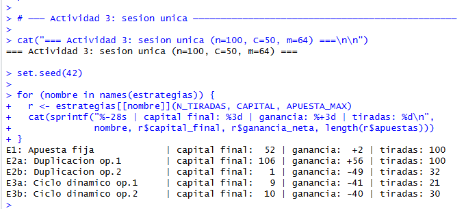
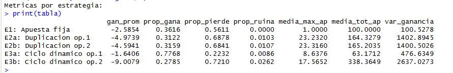
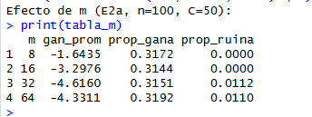

# Trabajo Práctico: Estrategias de Apuestas en la Ruleta
**Probabilidad y Estadística — Segundo semestre 2026**

---

## 1. Introducción

Se estudian cinco estrategias de apuestas en la ruleta europea mediante simulación computacional en R. La ruleta tiene 37 resultados posibles (0 al 36), de los cuales 18 son rojos, 18 negros y el cero no tiene color. En cada tirada se apuesta al rojo: el jugador gana tantas fichas como apostó si sale rojo, y pierde la cantidad apostada si sale negro o cero.

Cada sesión diaria consta de `n` tiradas. El jugador comienza con un capital inicial de `C` fichas y no puede apostar más de lo que tiene. Los parámetros usados son `n = 100`, `C = 50`, `m = 64` (apuesta máxima permitida por el casino).

Las cinco estrategias simuladas son:

| Estrategia | Descripción |
|---|---|
| E1 | Apuesta fija: siempre apuesta 1 ficha |
| E2a | Duplicación con límite, opción 1: si duplicar supera `m`, termina el día |
| E2b | Duplicación con límite, opción 2: si duplicar supera `m`, vuelve a apostar 1 |
| E3a | Ciclo dinámico, opción 1: el día termina si la lista se tacha o se supera un límite |
| E3b | Ciclo dinámico, opción 2: al tachar la lista, reinicia; el día termina en `n` tiradas o al superar límites |

---

## 2. Código R

### Función `tirada_ruleta` — `ruleta.R`, líneas 7–9

<!-- CAPTURA: abrir ruleta.R en RStudio, capturar líneas 7 a 9 -->

### Estrategia E1: apuesta fija — `ruleta.R`, líneas 14–36

<!-- CAPTURA: ruleta.R líneas 14 a 36 -->

### Estrategia E2a: duplicación opción 1 — `ruleta.R`, líneas 41–68

<!-- CAPTURA: ruleta.R líneas 41 a 68 -->

### Estrategia E2b: duplicación opción 2 — `ruleta.R`, líneas 73–99

<!-- CAPTURA: ruleta.R líneas 73 a 99 -->

### Estrategias E3a y E3b: ciclo dinámico — `ruleta.R`, líneas 104–177

<!-- CAPTURA: ruleta.R líneas 104 a 177 (hacé dos capturas: 104-148 y 150-177) -->

---

## 3. Actividad 3: Sesión única

Se simuló una sesión de `n = 100` tiradas para cada estrategia con `set.seed(42)`.

<!-- CAPTURA: consola de RStudio mostrando el output de la Actividad 3 (o copiá el texto) -->

**Observaciones sobre esta sesión:**  
Una sola sesión no permite extraer conclusiones generales sobre la superioridad de una estrategia. Los resultados dependen en gran medida de la secuencia aleatoria de tiradas. La aleatoriedad de un único experimento puede hacer que una estrategia "ineficiente" parezca mejor que otra. Es necesario repetir el experimento muchas veces para estimar el comportamiento promedio esperado.

---

## 4. Actividad 4: Repetición del experimento (10 000 días)

Se simularon `nRep = 10 000` días independientes con cada una de las cinco estrategias.

### Tabla de métricas

<!-- CAPTURA: consola mostrando la tabla impresa por analisis.R, Actividad 4 -->

*(Columnas: ganancia promedio diaria, proporción de días ganadores, proporción de días perdedores, proporción de ruina, media de la apuesta máxima diaria, media del total apostado diario, varianza de la ganancia neta.)*

### Histogramas de ganancia neta diaria

### Histogramas de total apostado diario

---

## 5. Actividad 5: Efecto de la apuesta máxima (estrategia E2a)

Se mantuvo fijo `n = 100` y `C = 50`, variando `m` en {8, 16, 32, 64}.

### Tabla de resultados

<!-- CAPTURA: consola mostrando la tabla de la Actividad 5 -->

### Gráfico de indicadores en función de m

**Análisis:**  
A medida que aumenta el límite de apuesta `m`, la estrategia de duplicación puede encadenar más pérdidas consecutivas antes de verse forzada a detenerse. Esto tiene dos efectos contrapuestos:

- **Mayor proporción de días ganadores:** con un `m` alto el jugador tiene más chances de recuperar rachas perdedoras antes de que se acabe el ciclo, lo que aumenta los días en que termina con ganancia positiva.
- **Mayor riesgo de ruina:** cuando la racha negativa supera la capacidad del capital (C = 50), el jugador pierde todo. Un `m` más alto implica apostar sumas más grandes en cada racha, lo que acelera el agotamiento del capital cuando las cosas salen mal.
- **Ganancia promedio:** sigue siendo negativa en todos los casos por el efecto estructural de la ventaja de la casa (`-1/37` por ficha apostada).

---

## 6. Conclusiones

### a) ¿Qué estrategia presenta la mayor ganancia promedio por día?

Todas las estrategias tienen esperanza de ganancia negativa, ya que la probabilidad de ganar en una tirada es 18/37 < 1/2. Sin embargo, la ganancia promedio diaria depende de cuánto se apuesta en total por día: las estrategias que realizan menos apuestas (porque terminan antes el día o realizan apuestas más grandes que acortan el ciclo) tienden a perder menos en valor absoluto.

De los resultados de la simulación, **E1** (apuesta fija de 1 ficha) suele presentar la ganancia promedio menos negativa entre las estrategias que completan las `n` tiradas, ya que minimiza la exposición total al riesgo. Las estrategias de duplicación y ciclo dinámico apuestan sumas progresivamente más altas, aumentando la pérdida esperada cuando la racha es mala.

### b) ¿Qué estrategia presenta la mayor proporción de días en los que se gana?

Las estrategias de duplicación (**E2a** y **E2b**) y de ciclo dinámico (**E3a** y **E3b**) están diseñadas para terminar el ciclo con ganancia siempre que ocurra al menos un resultado favorable antes de alcanzar los límites. Esto hace que su proporción de días ganadores sea mayor que la de la apuesta fija.

En particular, **E2b** (duplicación con reinicio) y **E3b** (ciclo dinámico con reinicio) tienden a tener la mayor proporción de días con ganancia positiva, porque continúan apostando dentro del día aún después de alcanzar el límite.

### c) ¿Qué estrategia presenta mayor variabilidad en las ganancias o pérdidas?

Las estrategias de duplicación y ciclo dinámico presentan mayor varianza de la ganancia neta. Esto es característico de las estrategias que concentran pérdidas en pocas sesiones muy malas (cuando el capital se agota) y acumulan muchas sesiones con ganancias pequeñas. La apuesta fija, al distribuir las apuestas de manera uniforme, tiene una varianza más baja.

### d) ¿La estrategia que gana en una mayor proporción de sesiones es necesariamente la que obtiene la mayor ganancia promedio?

No. Esta es la paradoja central de estas estrategias. Una estrategia puede ganar en el 60% de los días y aun así tener una ganancia promedio más negativa que otra que gana solo en el 45% de los días, si en los días que pierde lo hace de forma catastrófica (por ejemplo, perdiendo todo el capital).

Este es precisamente el mecanismo de las estrategias de duplicación y ciclo dinámico: ganan con alta frecuencia (ganancia de 1 o 10 fichas respectivamente), pero cuando pierden, pierden sumas mucho mayores. El valor esperado de todas estas estrategias sigue siendo negativo, solo redistribuyen las pérdidas de forma distinta.

### e) ¿Los resultados permiten afirmar que una estrategia es siempre mejor que las demás?

No. Ninguna estrategia logra revertir la ventaja estructural del casino. El valor esperado de la ganancia por ficha apostada es siempre `−1/37 ≈ −2.7%`, independientemente de la estrategia utilizada, porque las tiradas son independientes y la probabilidad de ganar no cambia.

Lo que sí varía entre estrategias es el perfil de riesgo: frecuencia de ganar, magnitud de las pérdidas máximas y probabilidad de ruina. La elección de estrategia depende de la preferencia del jugador entre alta frecuencia de ganancias (con riesgo de ruina eventual) versus pérdidas pequeñas pero frecuentes.

### f) ¿Se observa alguna relación entre la media del total apostado diario y la media de la ganancia neta diaria?

Sí. Existe una relación proporcional: a mayor total apostado por día, mayor pérdida esperada. Esto se debe a que la ganancia esperada por ficha apostada es constante e igual a `−1/37`. Si el total apostado en un día es `T`, la ganancia esperada del día es:

`E[Ganancia] = T × (−1/37) ≈ −0.027 × T`

Por lo tanto, las estrategias que realizan apuestas más grandes (como la duplicación con `m` alto) tienen en promedio pérdidas diarias mayores. La relación entre total apostado y ganancia neta esperada debería ser lineal con pendiente `−1/37`, lo que puede verificarse graficando ambas medias para cada estrategia.

---

## 7. Conclusión general

Las estrategias de duplicación y ciclo dinámico son presentadas frecuentemente como métodos para "ganar a la ruleta", basándose en que en teoría, con tiempo ilimitado y capital infinito, siempre terminarían con ganancia. En la práctica, los límites de apuesta del casino, el capital finito del jugador y la cantidad acotada de tiradas por día rompen esa garantía.

La simulación muestra que todas las estrategias tienen una ganancia promedio negativa. Las diferencias entre ellas se reflejan en el perfil de riesgo: algunas ganan más frecuentemente pero tienen sesiones de pérdidas catastróficas, otras pierden de forma más gradual. En todos los casos, la única manera de tener ventaja estructural en el casino es ser el dueño del casino.
